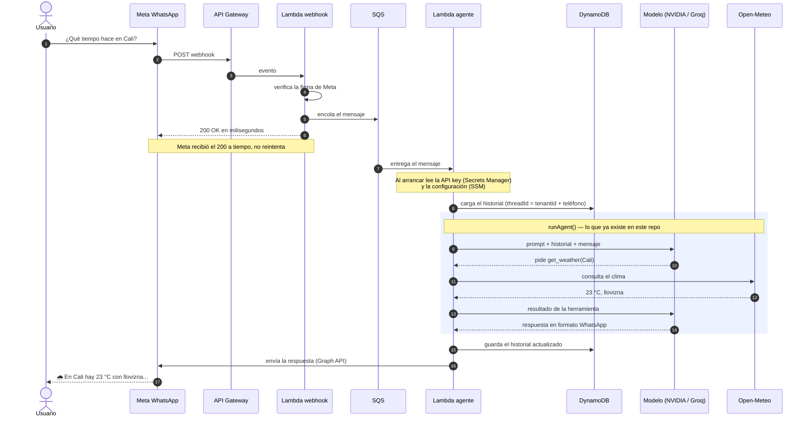

# Weather Agent (LangGraph + Groq / NVIDIA)

API HTTP mínima en **Node.js + TypeScript** que expone un agente conversacional construido con **LangGraph**. El agente usa un modelo de **Groq** o de **NVIDIA** (Nemotron), según `LLM_PROVIDER`, y tiene una herramienta para consultar el **clima actual** de cualquier ciudad (vía [Open-Meteo](https://open-meteo.com/), gratis y sin API key). Recuerda la conversación por `threadId` y devuelve los tokens de entrada y salida de cada respuesta.

Sirve como referencia de cómo montar un agente con herramientas en LangGraph JS con el mínimo de piezas: sin framework web, sin paso de compilación.

## Cómo funciona

```
POST /chat ──► server.ts ──► grafo LangGraph (agent.ts)
                               │
                 START ──► [llm] ──¿pidió una herramienta?── no ──► END ──► respuesta
                             ▲            │ sí
                             │            ▼
                             └──────── [tools] ── get_weather ──► Open-Meteo
```

1. El nodo `llm` envía el historial al modelo con la herramienta `get_weather` enlazada: `ChatGroq` para Groq, o `ChatOpenAI` apuntando al endpoint compatible con OpenAI de NVIDIA.
2. Si el modelo pide la herramienta, `toolsCondition` dirige al nodo `tools` (`ToolNode`), que la ejecuta y devuelve el resultado al modelo.
3. Se repite hasta que el modelo responde con texto. `recursionLimit: 10` corta un bucle infinito de herramientas.
4. `MemorySaver` guarda los mensajes de cada `thread_id`, así el siguiente mensaje del mismo hilo continúa la conversación.
5. Los tokens se leen de `usage_metadata` de cada respuesta del modelo en el turno y se suman.

## Requisitos

- **Node.js ≥ 23.6**: ejecuta TypeScript de forma nativa y lee `.env` con `--env-file`.
- Una API key del proveedor que vayas a usar (NVIDIA o Groq). Basta con una; cómo conseguirlas está justo abajo.

### Conseguir las API keys

Solo necesitas la del proveedor que pongas en `LLM_PROVIDER`. El proyecto viene configurado para NVIDIA.

**NVIDIA** (modelo Nemotron):

1. Entra en la página del modelo: <https://build.nvidia.com/nvidia/nemotron-3.5-super-vl-120b-a12b>
2. En el panel de la derecha, pulsa **Get API Key**.
3. Escribe tu email y pulsa **Next**. Si ya tienes cuenta de NVIDIA, inicia sesión. Si no, te pide crear una contraseña, y al registrarte quedas dentro del *NVIDIA Developer Program* (es gratis).
4. Al volver a la página del modelo aparece tu clave: pulsa **Copy Key**.
5. Pégala en `.env` como `NVIDIA_API_KEY=...`.

No hay una página aparte para gestionar las claves: se crean siempre desde la página de un modelo. Es un servicio de prueba con sus propias condiciones (*NVIDIA API Trial Terms of Service*).

**Groq**:

1. Entra en <https://console.groq.com/keys> e inicia sesión (o crea una cuenta).
2. Pulsa **Create API Key** y ponle un nombre.
3. Copia la clave.
4. Pégala en `.env` como `GROQ_API_KEY=...` y pon `LLM_PROVIDER=groq`.

Si usas Groq desde la cuenta de un equipo, solo los dueños del equipo o quien tenga el rol *developer* pueden crear claves.

> **Guarda la clave en un lugar seguro en cuanto la copies:** puede que no vuelva a mostrarse. Si la pierdes, crea una nueva. Nunca la pegues en el código ni la subas a git: va solo en `.env`, que está en `.gitignore`.

## Puesta en marcha

> **Windows / PowerShell:** si `npm` muestra *"la ejecución de scripts está deshabilitada en este sistema"*, usa `npm.cmd` en lugar de `npm` en todos los comandos (`npm.cmd install`, `npm.cmd run dev`...). Para arreglarlo de forma permanente, ejecuta una vez `Set-ExecutionPolicy -Scope CurrentUser RemoteSigned` (no necesita permisos de administrador).

```bash
npm install
```

Copia la plantilla de variables de entorno y pon tu API key en `.env`:

```bash
cp .env.template .env               # PowerShell: Copy-Item .env.template .env
```

| Variable         | Para qué                                               |
|------------------|--------------------------------------------------------|
| `LLM_PROVIDER`   | `nvidia` o `groq` (por defecto `groq`)                  |
| `NVIDIA_API_KEY` | Obligatoria si `LLM_PROVIDER=nvidia`                    |
| `GROQ_API_KEY`   | Obligatoria si `LLM_PROVIDER=groq`                      |
| `NVIDIA_REASONING_EFFORT` | Razonamiento de Nemotron: `none` (por defecto), `low` o `high` |
| `NVIDIA_MODEL`, `GROQ_MODEL`, `PORT`, `HOST` | Opcionales. Los valores por defecto están en [`.env.template`](.env.template) |

`.env` está en `.gitignore`, así que tus claves no se suben al repo.

## Configurar el modelo

Todos los parámetros del modelo están en [`src/model.ts`](src/model.ts), en la función `createChatModel()`. Cambia el valor y reinicia el servidor.

| Parámetro          | Dónde             | Qué hace |
|--------------------|-------------------|----------|
| `model`            | `.env` (`NVIDIA_MODEL` / `GROQ_MODEL`) | Qué modelo se usa |
| `temperature`      | `model.ts`        | 0 = respuestas siempre iguales; más alto = más variadas. NVIDIA recomienda 1 y Groq está en 0 |
| `maxTokens`        | `model.ts`        | Máximo de tokens que el modelo escribe por llamada (2048) |
| `reasoning_effort` | `.env` (`NVIDIA_REASONING_EFFORT`) | Si Nemotron "piensa" antes de responder. Va en `modelKwargs` |

`modelKwargs` es la forma de mandar a la API parámetros para los que LangChain no tiene opción propia: se envían tal cual. Así se pasa `reasoning_effort` a NVIDIA.

**¿Razonamiento sí o no?** Para tareas sencillas como esta, `none` da respuestas igual de buenas y es mucho más barato. Medido con el mismo prompt:

| Endpoint  | `none`  | `high`    |
|-----------|---------|-----------|
| `/report` | 87 tokens de salida | 1187 tokens de salida |
| `/chat`   | 74 tokens de salida | 341 tokens de salida  |

Usa `low` o `high` para problemas que requieren varios pasos de lógica: matemáticas, planificación o código.

```bash
npm run dev     # servidor con recarga automática en http://localhost:3000
npm start       # igual, sin recarga
```

## Prompts

Las instrucciones del modelo no están en el código: viven en la carpeta [`prompts/`](prompts) como archivos Markdown.

- [`whatsapp-agent.md`](prompts/whatsapp-agent.md): el agente de `/chat`. Define su rol, cuándo usar la herramienta, el tono, el formato de WhatsApp (`*negrita*`, listas con •, emojis con moderación, sin tablas) y sus límites.
- [`weather-report.md`](prompts/weather-report.md): las instrucciones del informe de `/report`.

**¿Por qué en archivos aparte?** Se editan como texto, sin tocar TypeScript. Cada cambio queda en git, así que se puede revisar y deshacer. Y quien escribe el prompt no necesita conocer el código.

**Variables.** Los prompts son plantillas en formato *mustache*, parecido a Jinja en Python: `{{variable}}` se reemplaza al usarlos. `whatsapp-agent.md` usa dos:

| Variable             | Valor |
|----------------------|-------|
| `{{assistant_name}}` | `ASSISTANT_NAME` del `.env` (por defecto `Nimbo`) |
| `{{today}}`          | La fecha de hoy, para que el modelo sepa qué día es |

**Cómo funciona** ([`src/prompts.ts`](src/prompts.ts)):

1. `loadChatPrompt()` lee el archivo y crea un `ChatPromptTemplate` de LangChain: primero el prompt de sistema y después la conversación.
2. Con `.pipe(model)` se conecta al modelo.
3. Si el archivo usa una variable que el código no envía (por ejemplo, un error de tipeo como `{{fehca}}`), el servidor no arranca. Sin esa comprobación, mustache la dejaría vacía sin avisar.

**Para agregar una variable:** escríbela en el `.md`, añádela a la lista de `loadChatPrompt(...)` y pásale su valor en `invoke(...)`, como en [`src/agent.ts`](src/agent.ts).

> ¿Y Jinja? En Node existe [Nunjucks](https://mozilla.github.io/nunjucks/), que admite `if` y `for` dentro de la plantilla. Aquí no hace falta: mustache ya viene con LangChain, sin dependencias extra, y un prompt con poca lógica es más fácil de leer.

## Documentación (Swagger)

Con el servidor encendido:

- **Swagger UI:** <http://localhost:3000/docs>, para probar la API desde el navegador.
- **Spec OpenAPI:** <http://localhost:3000/openapi.json>, fuente en [`openapi.json`](openapi.json).

## API

### `POST /chat`

| Campo      | Tipo   | Obligatorio | Descripción                                                    |
|------------|--------|-------------|----------------------------------------------------------------|
| `message`  | string | sí          | Mensaje del usuario                                            |
| `threadId` | string | no          | Id de conversación. Si no se envía, se crea uno nuevo y se devuelve |

Respuesta `200`:

```json
{
  "reply": "En Bogotá hace 17.7 °C...",
  "threadId": "4939598e-8563-4df3-aa99-514dd9d2d1a1",
  "usage": { "inputTokens": 898, "outputTokens": 422 }
}
```

`usage` suma los tokens de **este turno**: si el agente usó la herramienta hubo 2 llamadas al modelo. Los tokens de entrada de cada llamada incluyen el historial, así que crecen a medida que avanza la conversación. Con NVIDIA, los de salida incluyen los tokens de razonamiento.

Errores: `400` (JSON inválido, falta `message`, `threadId` con formato incorrecto) y `502` (fallo al llamar al modelo). Formato: `{ "error": "..." }`.

### Ejemplo: conversación de dos turnos

```bash
curl -X POST http://localhost:3000/chat -H "Content-Type: application/json" \
  -d '{"message":"¿Qué tiempo hace en Medellín?"}'
# → {"reply":"...","threadId":"<id>"}

curl -X POST http://localhost:3000/chat -H "Content-Type: application/json" \
  -d '{"message":"¿Y comparado con Cartagena?","threadId":"<id>"}'
```

PowerShell:

```powershell
$r = Invoke-RestMethod -Method Post -Uri http://localhost:3000/chat -ContentType 'application/json' `
  -Body '{"message":"¿Qué tiempo hace en Medellín?"}'
Invoke-RestMethod -Method Post -Uri http://localhost:3000/chat -ContentType 'application/json' `
  -Body (@{ message = '¿Y comparado con Cartagena?'; threadId = $r.threadId } | ConvertTo-Json)
```

### "El agente no recuerda lo que le pregunté"

La memoria funciona por `threadId`. Si no lo envías, cada mensaje empieza una conversación nueva:

| Pregunta | `threadId` | Respuesta |
|---|---|---|
| ¿Qué tiempo hace en Cali? | (ninguno, se crea uno) | 🌧️ 23 °C con llovizna… |
| ¿Cuál fue mi primera pregunta? | el mismo de la respuesta anterior | Tu primera pregunta fue "¿Qué tiempo hace en Cali?" ✅ |
| ¿Cuál fue mi primera pregunta? | sin `threadId` | Es tu primera vez que me escribes ❌ |

**En Swagger** es fácil olvidarlo, porque el ejemplo por defecto solo trae `message`:

1. Haz la primera pregunta y copia el `threadId` de la respuesta.
2. En las siguientes peticiones, añádelo al body: `{"message": "...", "threadId": "<el que copiaste>"}`. En el desplegable **Examples** está el ejemplo "Continuar conversación", que ya trae el campo `threadId`.

**Cómo comprobarlo en los logs:** mira `historyMessages` en la línea `agent done`. Si crece (4 → 8 → 10), es la misma conversación. Si siempre vale 2, no está llegando el `threadId`.

**Si reinicias el servidor, la memoria se borra** porque vive en RAM. Ojo: `npm run dev` reinicia el servidor cada vez que guardas un archivo. Para probar conversaciones largas, usa `npm start`, que no se reinicia solo.

### `POST /report`: salida estructurada (JSON)

Ejemplo de **structured output**: en lugar de texto libre, el modelo está obligado a devolver un JSON con una forma fija. La forma se define con `zod` en [`src/report.ts`](src/report.ts), y `withStructuredOutput(..., { method: 'jsonSchema' })` la envía a la API como `response_format: { type: "json_schema" }`. Además valida la respuesta: si el modelo devolviera algo que no cumple el esquema, la petición falla en vez de llegar mal al cliente.

```bash
curl -X POST http://localhost:3000/report -H "Content-Type: application/json" -d '{"city":"Bogotá"}'
```

```json
{
  "report": {
    "city": "Bogotá",
    "country": "Colombia",
    "temperatureC": 17.3,
    "condition": "Llovizna ligera",
    "feeling": "fresco",
    "umbrellaNeeded": true,
    "recommendation": "Lleva paraguas y una chaqueta ligera."
  },
  "usage": { "inputTokens": 159, "outputTokens": 892 }
}
```

Errores: `400` (falta `city`), `404` (ciudad no encontrada), `502` (fallo del modelo).

> En PowerShell 5.1, usa `-ContentType 'application/json; charset=utf-8'` para que los acentos (á, ñ) lleguen bien.

## Logs: qué pasa en cada petición

Cada petición recibe un id corto, que aparece en todas sus líneas de log y en el header `X-Request-Id` de la respuesta. Una pregunta por el clima se ve así en la terminal:

```
INFO  [aca4f8a4] → request method=POST url=/chat
INFO  [aca4f8a4] llm ms=38885 toolCalls=get_weather inputTokens=361 outputTokens=27
INFO  [aca4f8a4] tool get_weather city=Bogotá ms=1349 found=true
INFO  [aca4f8a4] llm ms=684 toolCalls=none inputTokens=531 outputTokens=44
INFO  [aca4f8a4] agent done threadId=af0c118b-... historyMessages=4 inputTokens=892 outputTokens=71
INFO  [aca4f8a4] ← response status=200 ms=40961
```

Se lee de arriba abajo:

1. El modelo pidió la herramienta `get_weather`.
2. La herramienta consultó Open-Meteo, que tardó 1.3 s.
3. El modelo redactó la respuesta.

`historyMessages` crece con cada mensaje del mismo `threadId`: es la memoria. Y `ms` muestra dónde se va el tiempo; en este ejemplo, casi todo en la primera llamada al modelo.

**Errores:**

- **Fallo del proveedor del modelo** (por ejemplo, una API key inválida): el log muestra una línea `ERROR` con el status del proveedor, una pista (`hint`) y el stack completo. El cliente solo recibe `{"error": "...", "requestId": "..."}`; con ese `requestId` se buscan los detalles en el log.
- **Petición mal formada:** aparece como `WARN client error`.

El logger está en [`src/log.ts`](src/log.ts). Usa `AsyncLocalStorage` de Node para que el id de la petición llegue a los logs del agente y de las herramientas sin pasarlo de función en función.

## Estructura

```
src/
  server.ts       Servidor HTTP (node:http): validación de entrada, /chat, /report, /docs, /openapi.json
  model.ts        Selección del modelo (Groq o NVIDIA) y conteo de tokens
  log.ts          Logger (una línea por evento) con el id de petición vía AsyncLocalStorage
  agent.ts        Grafo LangGraph: nodo llm + ToolNode y memoria (MemorySaver)
  report.ts       Salida estructurada: esquema zod + withStructuredOutput
  prompts.ts      Carga los prompts de /prompts como plantillas
  weather.ts      Herramienta get_weather (tool() + esquema zod) y cliente de Open-Meteo
tests/
  agent.test.ts   Tests con fetch simulado (no llaman a Groq ni a Open-Meteo)
prompts/
  whatsapp-agent.md   Instrucciones del agente de /chat (rol, estilo, formato WhatsApp, límites)
  weather-report.md   Instrucciones del informe de /report
openapi.json      Contrato de la API (lo sirve /openapi.json y lo usa Swagger UI)
```

### Agregar otra herramienta

1. Defínela con `tool()` y un esquema `zod`, como `weatherTool` en [`src/weather.ts`](src/weather.ts).
2. Añádela al array `tools` en [`src/agent.ts`](src/agent.ts). `bindTools` y `ToolNode` usan ese mismo array, así que no hace falta tocar nada más.

## Scripts

| Script              | Qué hace                                     |
|---------------------|----------------------------------------------|
| `npm run dev`       | Servidor con `--watch`                       |
| `npm start`         | Servidor                                     |
| `npm test`          | Tests (`node --test`)                        |
| `npm run typecheck` | Comprobación de tipos con `tsc` (no compila) |
| `npm run format`    | Da formato al código con Prettier            |
| `npm run format:check` | Revisa el formato sin cambiar nada (útil en CI) |

En VS Code, si instalas la extensión de Prettier (el editor te la sugiere al abrir el proyecto), el código se formatea solo al guardar.

## Limitaciones (a propósito, es una referencia)

- **La memoria vive en RAM:** se pierde al reiniciar, y `npm run dev` reinicia en cada cambio. Para persistirla, sustituye `MemorySaver` por un checkpointer de SQLite o Postgres.
- **Al modelo solo le llegan los últimos 20 mensajes** (`MAX_HISTORY_MESSAGES` en [`src/agent.ts`](src/agent.ts)), para que el costo no crezca sin límite. Lo más antiguo de una conversación larga se "olvida", aunque siga guardado en memoria.
- **Sin autenticación:** cualquiera que conozca un `threadId` puede leer o continuar esa conversación. Por eso el servidor solo acepta conexiones de tu propio equipo (`HOST=127.0.0.1`). No lo cambies a `0.0.0.0` sin añadir autenticación antes.
- **Las llamadas al modelo tienen un timeout de 60 s y como máximo 2 reintentos** ([`src/model.ts`](src/model.ts)). Si el proveedor no responde, la API devuelve un `502` en lugar de quedarse esperando.
- **Swagger UI se carga desde un CDN** (unpkg), así que `/docs` necesita internet.
- **El contrato `openapi.json` se mantiene a mano:** si cambias el endpoint, actualízalo también.

## De este ejemplo a la arquitectura *agent-col*

Este repo es un **prototipo local** de una sola pieza de la arquitectura *My Business Agents (agent-col)*: el **procesamiento de mensajes** (la *Lambda API* que recibe los mensajes de Meta WhatsApp). La lógica del agente (grafo, herramienta, prompts, salida estructurada) ya existe aquí. Lo que cambia es la infraestructura que la rodea.

El diagrama completo de la arquitectura está en [`docs/agent-col.drawio`](docs/agent-col.drawio). Se edita con [draw.io](https://www.drawio.com/) o con su extensión para VS Code.

### Qué pieza corresponde a qué

| En la arquitectura | En este repo | Qué hay que cambiar |
|---|---|---|
| **Lambda API** (procesamiento de mensajes) | `runAgent()` en [`src/agent.ts`](src/agent.ts) | Nada en la lógica: `runAgent(message, threadId)` no depende de HTTP. Solo se reemplaza [`src/server.ts`](src/server.ts) (`node:http`) por un *handler* de Lambda que lo llame. |
| **Meta WhatsApp** (mensajes, webhooks) | El prompt [`prompts/whatsapp-agent.md`](prompts/whatsapp-agent.md) ya responde en formato WhatsApp | Falta el webhook: verificar la firma de Meta (`X-Hub-Signature-256`), leer el mensaje entrante y responder vía la Graph API de Meta. Directo con Meta, **sin Twilio**, como pide el diagrama. |
| **DynamoDB** (`tenantId` en todas las consultas) | `MemorySaver` (memoria en RAM) | **Imprescindible:** en Lambda la RAM no sobrevive entre invocaciones, así que hay que sustituirlo por un checkpointer persistente sobre DynamoDB. Puede ser uno de la comunidad o uno propio que implemente `BaseCheckpointSaver` de LangGraph. El `threadId` debe incluir el tenant, por ejemplo `${tenantId}#${telefono}`, para aislar las conversaciones de cada cliente. |
| **SQS** (procesamiento asíncrono) | No existe: `/chat` responde de forma síncrona | **Necesario:** el modelo tarda entre 20 y 40 s en responder, API Gateway corta por defecto a los 29 s y Meta espera un `200` rápido o reintenta el envío. Ver el flujo de abajo. |
| **Secrets Manager** | `NVIDIA_API_KEY` / `GROQ_API_KEY` en `.env` | Las claves se leen de Secrets Manager. |
| **SSM Parameter Store** (configuración parametrizable) | `LLM_PROVIDER`, `NVIDIA_MODEL`, `NVIDIA_REASONING_EFFORT`, `ASSISTANT_NAME` en `.env` | Pasan a parámetros de SSM, y pueden ser distintos por tenant. |
| **Parametrizable por tenant** (colores de marca, temas) | Variables mustache `{{assistant_name}}`, `{{today}}` en [`prompts/`](prompts) | Es la misma idea aplicada al prompt: el nombre del asistente, el tono o las instrucciones pueden venir de la configuración de cada tenant (DynamoDB o S3) en lugar del `.env`. |
| **CloudWatch** (logs, métricas, alarmas) | [`src/log.ts`](src/log.ts): una línea `clave=valor` por evento, con `requestId` | En Lambda, `console.log` ya llega a CloudWatch Logs. Falta añadir `tenantId` al contexto del log (el mismo `AsyncLocalStorage`) y publicar los tokens de `usage` como métricas por tenant, útil para costos y alarmas. |
| **API Gateway + Cognito** | `HOST=127.0.0.1` (sin autenticación) | Las rutas internas (el *Backend Composer*) van detrás de API Gateway con autorizador de Cognito. El webhook de Meta no usa Cognito: se protege verificando la firma. [`openapi.json`](openapi.json) se puede importar en API Gateway. |
| **Pipeline CI/CD** (GitHub Actions → OIDC → SAM) | `npm run typecheck`, `npm test`, `npm run format:check` | Son los pasos de validación antes del deploy. El runtime de Lambda no ejecuta `.ts` directamente como Node 26 en local, así que se empaqueta con esbuild (SAM lo soporta). |
| **Timeouts y reintentos** | `timeout: 60s`, `maxRetries: 2` en [`src/model.ts`](src/model.ts) | El timeout de la Lambda debe ser mayor que el del modelo, y el *visibility timeout* de SQS mayor que el de la Lambda. Los mensajes que fallen varias veces van a una cola de errores (DLQ). |

### El flujo de un mensaje de WhatsApp en la nube



Separar la recepción (rápida) del procesamiento (lento) con SQS es lo que permite usar un modelo que tarda 30 s sin que Meta reintente el mensaje ni API Gateway corte la petición.

### Fuera del alcance de este ejemplo

- **Agente de voz (ECS Fargate):** las llamadas duran más de 3 minutos y necesitan una conexión abierta todo ese tiempo, por eso van en un contenedor y no en Lambda. Este repo solo maneja texto. El grafo y las herramientas se podrían reutilizar, pero la parte de audio es otro mundo.
- **Angular MFE (Visual Workflow):** el editor visual de flujos (Inicio → ¿Condición? → Acción → Fin) es, conceptualmente, lo mismo que el grafo de LangGraph de [`src/agent.ts`](src/agent.ts): nodos, una arista condicional y un final. Un flujo diseñado ahí podría traducirse a un `StateGraph`, pero esa traducción no está en este repo.
- **Multitenancy completo:** Cognito, aislamiento por `tenantId` y auditoría inmutable en CloudWatch. Aquí solo hay un "tenant" implícito.
